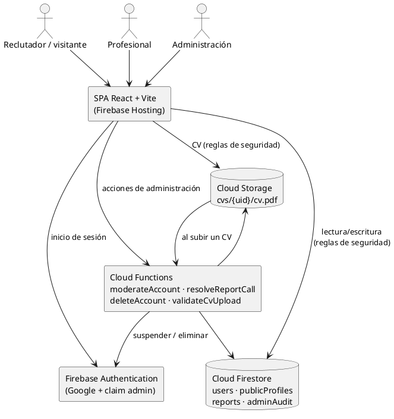

# itti talentos

Directorio de profesionales y CV para la comunidad de ITTI y Grupo Vázquez. Las empresas y reclutadores buscan talento; cada profesional crea su perfil, sube su CV y decide si lo publica.

> **Iniciativa personal, independiente y no oficial.** No está afiliada, patrocinada ni respaldada por ITTI ni por Grupo Vázquez. Responsable: Carlos Alberto Figueredo Quevedo.

## Contenido

- [Funcionalidades](#funcionalidades)
- [Stack](#stack)
- [Arquitectura](#arquitectura)
- [Estructura del repositorio](#estructura-del-repositorio)
- [Ambientes](#ambientes)
- [Puesta en marcha local](#puesta-en-marcha-local)
- [Variables de entorno](#variables-de-entorno)
- [Scripts](#scripts)
- [Pruebas](#pruebas)
- [Despliegue](#despliegue)
- [Seguridad y privacidad](#seguridad-y-privacidad)
- [Costos](#costos)
- [Limitaciones conocidas](#limitaciones-conocidas)
- [Estado del proyecto](#estado-del-proyecto)
- [Documentación](#documentación)
- [Contribuir](#contribuir)

## Funcionalidades

**Reclutadores y visitantes (sin cuenta)**
- Inicio con el directorio de perfiles publicados.
- Caja de búsqueda por puesto, habilidad, ciudad o nombre (por palabra clave, sin importar tildes).
- Filtros por área, país, ciudad, experiencia, modalidad y disponibilidad; filtros rápidos "Disponibles" y "Remoto". Los filtros quedan en la URL y se pueden compartir.
- Perfil público con descarga del CV en PDF.
- Reporte de perfiles inapropiados (requiere iniciar sesión).

**Profesionales**
- Ingreso con Google.
- Perfil profesional validado; privado hasta que se publica.
- Consentimiento separado para mostrar email, teléfono y la respuesta "¿Afectado Grupo Vázquez?".
- Subir, reemplazar, descargar y eliminar el CV (PDF de hasta 5 MB).
- Publicar y dejar de publicar el perfil en cualquier momento.
- Eliminar la cuenta (con confirmación de Google).

**Administración**
- Estadísticas, lista de usuarios, cola de reportes y auditoría.
- Despublicar perfiles, eliminar CV, suspender, reactivar y eliminar cuentas. Ver [docs/administracion.md](docs/administracion.md).

**General**
- Tema claro y oscuro (sigue al sistema y recuerda la elección).
- 100 % responsive, verificado con Playwright en 320, 390, 768 y 1280 px.
- Textos legales: términos, privacidad y descargo de responsabilidad.

## Stack

| Capa | Tecnología |
|------|------------|
| Frontend | React 19, Vite 8, TypeScript (estricto), Material UI 6, React Router 7, React Hook Form, Zod, Day.js |
| Backend | Firebase Authentication (Google), Cloud Firestore, Cloud Storage, Cloud Functions (2.ª gen., Node 22), Firebase Hosting |
| Pruebas | Vitest, React Testing Library, Firebase Emulator Suite, Playwright |
| CI | GitHub Actions |

No usa servidores propios, contenedores ni bases SQL.

## Arquitectura



### Datos

| Ubicación | Contenido | Acceso |
|-----------|-----------|--------|
| `users/{uid}` | Datos privados de la cuenta: email, nombre, respuesta privada sobre Grupo Vázquez, estado (`active` / `suspended`). | Dueño y administración. El dueño no puede cambiar su estado. |
| `publicProfiles/{uid}` | Perfil profesional, consentimientos, metadatos del CV y palabras clave de búsqueda. | Público solo si `isPublic == true`. Dueño y administración siempre. |
| `cvs/{uid}/cv.pdf` | CV en PDF (máx. 5 MB). | Público solo si el perfil está publicado. Sin URLs permanentes con token. |
| `reports/{perfil}_{reportante}` | Reportes (uno por persona y perfil). | Crear: con sesión. Leer: administración. |
| `adminAudit/{id}` | Registro de acciones de administración (sin contenido personal). | Lo escriben solo las funciones; lo lee la administración. |

Más detalle en [`.kiro/specs/talent-platform/design.md`](.kiro/specs/talent-platform/design.md).

## Estructura del repositorio

```text
.
├── src/
│   ├── components/   # UI por dominio: admin, common, cv, layout, legal, profile, search
│   ├── pages/        # Páginas (rutas), incluye pages/legal
│   ├── services/     # Acceso a Firebase (Auth, Firestore, Storage, Functions)
│   ├── hooks/        # Hooks de datos y de UI
│   ├── context/      # Sesión (AuthProvider)
│   ├── firebase/     # Inicialización y validación de variables de entorno
│   ├── schemas/      # Validación con Zod
│   ├── types/        # Tipos de dominio
│   ├── routes/       # Rutas y guardas (RequireAuth, RequireAdmin)
│   ├── config/       # Configuración (textos legales)
│   ├── theme/        # Tema de MUI (paleta, tipografía, claro/oscuro)
│   └── utils/        # Normalización, palabras clave, catálogos, validación de PDF
├── functions/        # Cloud Functions (TypeScript) y scripts de administración
├── tests/rules/      # Pruebas de reglas de Firestore y Storage (emuladores)
├── e2e/              # Pruebas de punta a punta y datos ficticios (Playwright)
├── docs/             # Documentación del proyecto
├── .kiro/specs/      # Especificación: requisitos, diseño y tareas
├── .github/          # CI, CODEOWNERS, guía de contribución y política de seguridad
├── firestore.rules · firestore.indexes.json · storage.rules
├── storage.cors.dev.json · storage.cors.prod.json
└── firebase.json · .firebaserc
```

La lógica de Firebase vive en `services/` y `firebase/`, nunca en los componentes visuales.

## Ambientes

| Ambiente | Proyecto Firebase | Alias (`.firebaserc`) | Archivo de entorno | Región |
|----------|-------------------|-----------------------|--------------------|--------|
| Desarrollo | `cv-itti-dev` | `dev` (por defecto) | `.env.dev.local` | `us-central1` |
| Producción | `cv-itti` | `prod` | `.env.prod.local` | `us-central1` |
| Local | `demo-cv-itti` (ficticio) | — | `.env.emulators` (en el repo) | emuladores |

- Cada proyecto tiene Firestore, Storage (bucket `<proyecto>.firebasestorage.app`), Authentication con Google, plan Blaze y una alerta de presupuesto de USD 5.
- `us-central1` se eligió por costo: los buckets en esa región pueden usar el nivel *Always Free* de Cloud Storage.
- Los archivos `.env.*.local` no se suben al repositorio.

Configuración paso a paso de un proyecto Firebase: [docs/firebase-setup.md](docs/firebase-setup.md).

## Puesta en marcha local

### Requisitos

- Node.js ≥ 22.12 (probado con la LTS 26). Con nvm: `nvm install --lts`.
- Java 21 o superior (para los emuladores de Firestore y Storage).
- La CLI de Firebase viene como dependencia de desarrollo: `npx firebase ...`.

### Instalar

```bash
git clone https://github.com/carlitosfigueredo/cv-itti.git
cd cv-itti
npm ci
npm ci --prefix functions
```

### Opción A: con emuladores (sin credenciales)

```bash
npm --prefix functions run build   # una vez, para el emulador de Functions
npm run emulators   # terminal 1: Auth, Firestore, Storage, Functions, UI en http://127.0.0.1:4000
npm run dev:emu     # terminal 2: app en http://localhost:5173
```

Usa el proyecto ficticio `demo-cv-itti`: nunca toca datos reales. Para cargar perfiles de prueba, ver `e2e/seed.mjs`.

### Opción B: contra el proyecto de desarrollo

1. Copiá `.env.example` a `.env.dev.local` y completá los valores de la web app de `cv-itti-dev` (Firebase console → Project settings → Your apps).
2. `npm run dev`.
3. Si el inicio de sesión da `auth/unauthorized-domain`, agregá el dominio en Authentication → Settings → Authorized domains.

Si falta alguna variable `VITE_FIREBASE_*`, la app muestra cuáles faltan en lugar de arrancar.

### Ser administrador

Ver [docs/administracion.md](docs/administracion.md#otorgar-o-quitar-el-rol).

## Variables de entorno

Todas son públicas en el navegador (las variables `VITE_*` se incluyen en el build). **Nunca** pongas credenciales de Admin SDK ni llaves de servicio acá.

| Variable | Obligatoria | Descripción |
|----------|-------------|-------------|
| `VITE_FIREBASE_API_KEY` … `VITE_FIREBASE_APP_ID` | Sí | Configuración de la web app de Firebase. No son secretos: la seguridad está en las reglas. |
| `VITE_USE_EMULATORS` | No | `true` para conectar a los emuladores locales. |
| `VITE_LEGAL_OWNER` | Para publicar | Nombre del responsable que figura en los textos legales. |
| `VITE_LEGAL_CONTACT_EMAIL` | Para publicar | Email de contacto y para ejercer derechos sobre datos. Si falta, las páginas legales muestran un aviso de borrador. |

## Scripts

| Script | Qué hace |
|--------|----------|
| `npm run dev` | App local contra `cv-itti-dev`. |
| `npm run dev:emu` | App local contra los emuladores. |
| `npm run emulators` | Levanta los emuladores. |
| `npm run build` | Build de producción (usa `.env.prod.local`). |
| `npm run build:dev` | Build apuntando a desarrollo. |
| `npm run preview` | Sirve el build localmente. |
| `npm run lint` | ESLint. |
| `npm run typecheck` | TypeScript del frontend y de `functions/`. |
| `npm test` | Pruebas unitarias y de componentes (Vitest). |
| `npm run test:rules` | Pruebas de reglas de Firestore y Storage contra emuladores. |
| `npm run test:functions` | Pruebas de las Cloud Functions contra emuladores. |
| `npm run test:e2e` | Pruebas de punta a punta y responsive con Playwright (la primera vez: `npx playwright install chromium`). |

## Pruebas

| Tipo | Dónde | Qué cubre |
|------|-------|-----------|
| Unitarias y componentes | `src/**/*.test.ts(x)`, `functions/src/*.test.ts` | Validaciones, normalización, palabras clave, filtros, formularios, guardas de ruta, páginas. |
| Reglas de seguridad | `tests/rules/` | Acceso a cada colección y al CV, consentimientos, escalamiento de privilegios, consultas del directorio. |
| Funciones | `functions/test/` | Moderación, suspensión, borrado de cuenta y auditoría con emuladores de Auth, Firestore y Storage. |
| Punta a punta | `e2e/` | Inicio, búsqueda, filtros, perfil público, login y textos legales en 4 anchos, tema claro y oscuro; detecta desbordes horizontales. |

La CI (`.github/workflows/ci.yml`) corre lint, tipos, pruebas unitarias, build, reglas y funciones en cada pull request.

## Despliegue

Siempre con el proyecto explícito (`--project dev` o `--project prod`). Producción solo con aprobación.

```bash
# Reglas e índices (esperar a que los índices esten en READY antes de usar el directorio)
npx firebase deploy --only firestore:rules,firestore:indexes,storage --project dev
gcloud firestore indexes composite list --project=cv-itti-dev --format="value(state)"

# Cloud Functions
npx firebase deploy --only functions --project dev

# CORS del bucket (necesario para descargar CV desde el navegador)
gcloud storage buckets update gs://cv-itti-dev.firebasestorage.app --cors-file=storage.cors.dev.json

# Hosting
npm run build:dev && npx firebase deploy --only hosting --project dev
```

Para producción: `npm run build`, `--project prod`, `storage.cors.prod.json` y completar las variables legales en `.env.prod.local`.

## Seguridad y privacidad

- Reglas de Firestore y Storage con denegación por defecto, validación campo por campo y pruebas automatizadas.
- Perfiles y CV privados por defecto; publicación y datos de contacto con consentimiento explícito y separado.
- Rol de administrador como *custom claim*, otorgado solo desde código de confianza. Acciones de moderación en Cloud Functions con verificación en el servidor y auditoría.
- Validación de PDF en tres capas: navegador (tipo, tamaño y firma `%PDF-`), reglas de Storage (tipo y 5 MB) y la función `validateCvUpload` (contenido real).
- Encabezados de seguridad en Hosting (HSTS, `X-Frame-Options`, `nosniff`, `Referrer-Policy`).
- Sin analítica ni cookies publicitarias. Los logs no registran datos personales.
- Textos legales en `/legal/*`, tomando como referencia la Ley N.º 7593/2025 de Paraguay. **Borrador: requieren revisión legal.**

Reportar vulnerabilidades: [.github/SECURITY.md](.github/SECURITY.md).

## Costos

- Plan Blaze en ambos proyectos, con alerta de presupuesto de USD 5 por mes (avisa al 50, 90 y 100 %; no corta el gasto).
- Las búsquedas paginan de a 20 (21 lecturas por página) y las estadísticas usan consultas de conteo.
- A 5 MB por CV, 3.000 CV ocupan como máximo unos 15 GB.

## Limitaciones conocidas

- La caja de búsqueda encuentra una palabra a la vez (Firestore no tiene búsqueda de texto completo). Si hace falta más, ver [docs/search.md](docs/search.md) (Algolia / Typesense).
- Los perfiles guardados antes de la búsqueda por palabras clave no aparecen al buscar por texto hasta que su dueño los vuelve a guardar.
- Al ser una SPA, los perfiles públicos no están optimizados para buscadores (SEO).
- App Check y la *Content Security Policy* todavía no están configurados.
- El archivo JavaScript más grande pesa ~640 kB (incluye el SDK de Firebase); pendiente de optimizar.

## Estado del proyecto

| Fase | Estado |
|------|--------|
| 0–7: base, Firebase, login, perfil, CV, publicación, directorio | Completas |
| Rediseño, buscador, textos legales, CI y protección de `main` | Completos |
| 8: administración y moderación | Implementada; falta desplegar las Cloud Functions |
| 9: seguridad y rendimiento (App Check, CSP, auditoría de dependencias) | Pendiente |
| 10: publicación en producción | Pendiente |

Detalle por fase en [`.kiro/specs/talent-platform/tasks.md`](.kiro/specs/talent-platform/tasks.md) y cambios en [docs/change-tracker.md](docs/change-tracker.md).

## Documentación

| Documento | Contenido |
|-----------|-----------|
| [docs/firebase-setup.md](docs/firebase-setup.md) | Crear y conectar proyectos Firebase, emuladores, CORS. |
| [docs/search.md](docs/search.md) | Búsqueda, filtros, índices y limitaciones. |
| [docs/administracion.md](docs/administracion.md) | Rol de administrador, panel y moderación. |
| [docs/change-tracker.md](docs/change-tracker.md) | Registro de cambios. |
| [.kiro/specs/talent-platform/](.kiro/specs/talent-platform/) | Requisitos, diseño y plan de tareas. |

## Contribuir

Ver [.github/CONTRIBUTING.md](.github/CONTRIBUTING.md). La rama `main` está protegida: los cambios entran por pull request con revisión del responsable del código y la CI en verde.

Licencia: pendiente de definir.
