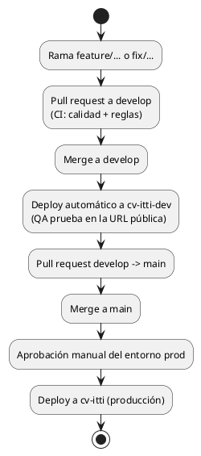

# Despliegue continuo

| Rama | Ambiente | Proyecto | URL pública | Aprobación |
|------|----------|----------|-------------|------------|
| `develop` | dev (QA) | `cv-itti-dev` | https://cv-itti-dev.web.app | Automático |
| `main` | prod | `cv-itti` | https://cv-itti.web.app | Requiere aprobación del entorno `prod` en GitHub |

## Flujo de ramas



## Qué hace el workflow (`.github/workflows/deploy.yml`)

1. Instala dependencias, corre las pruebas y hace el build con la configuración del ambiente.
2. Obtiene credenciales de Google con **Workload Identity Federation** (sin llaves guardadas en GitHub).
3. Despliega **solo Firebase Hosting** (`firebase deploy --only hosting`).

Las reglas, índices y Cloud Functions **no** se despliegan automáticamente (ver abajo).

## Configuración

### En Google Cloud (por proyecto)

- Cuenta de servicio `github-deploy@<proyecto>.iam.gserviceaccount.com` con `roles/firebasehosting.admin` y `roles/serviceusage.serviceUsageConsumer`. Nada más.
- Pool de identidades `github` y proveedor `cv-itti-repo` que solo acepta tokens de este repositorio (por id) y de su rama: `refs/heads/develop` en `cv-itti-dev`, `refs/heads/main` en `cv-itti`.

### En GitHub (Settings → Environments)

- `dev`: solo la rama `develop`.
- `prod`: solo la rama `main` y aprobación requerida.
- Variables de cada entorno: `VITE_FIREBASE_*`, `VITE_LEGAL_OWNER`, `VITE_LEGAL_CONTACT_EMAIL`, `FIREBASE_PROJECT_ID`, `GCP_WIF_PROVIDER`, `GCP_DEPLOY_SA`. Son configuración pública (no secretos).

Para cambiar una variable: `gh variable set NOMBRE --env dev --body "valor"`.

## Backend (reglas, índices, funciones)

Se despliega a mano, con el proyecto explícito, cuando cambian esos archivos:

```bash
npx firebase deploy --only firestore:rules,firestore:indexes,storage --project dev
npx firebase deploy --only functions --project dev
```

Motivo: darle a GitHub permisos para desplegar funciones y reglas requiere roles mucho más amplios (incluido actuar como otras cuentas de servicio). Se puede automatizar más adelante si el equipo lo prefiere.

## Revocar el acceso de GitHub

```bash
gcloud iam workload-identity-pools providers delete cv-itti-repo --location=global --workload-identity-pool=github --project=cv-itti-dev
gcloud iam service-accounts delete github-deploy@cv-itti-dev.iam.gserviceaccount.com --project=cv-itti-dev
```
